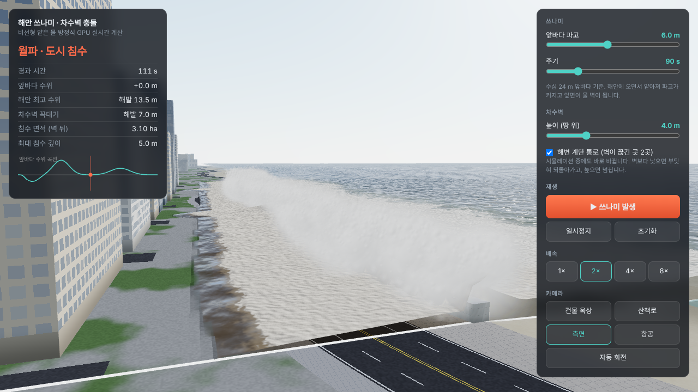
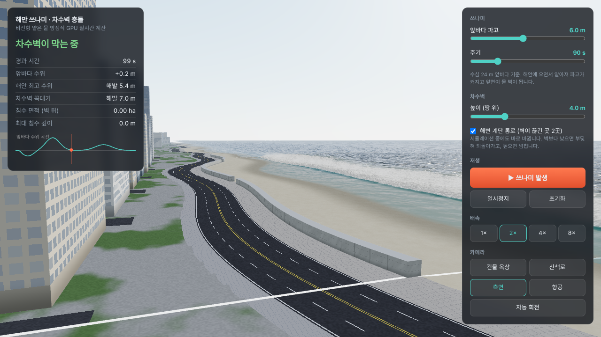
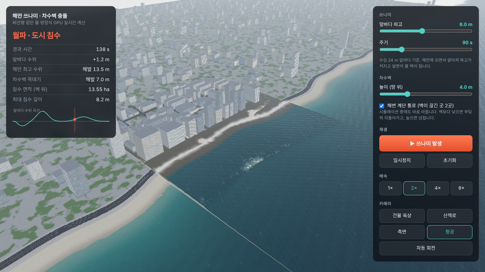

# 쓰나미 실시간 시뮬레이션 — `/tsunami.html`

> 차수벽 높이·쓰나미 파고·주기를 바꾸면, 파도가 밀려와 **부딪히고 되돌아가거나 넘쳐서 도시를 잠기게 하는 모습**이 실시간으로 계산된다.



| 접근 (물 벽이 다가옴) | 도시 침수 (항공) |
|---|---|
|  |  |

---

## 1. 무엇이 달라졌나 (기존 Phase 5 홍수와 비교)

| | 기존 `core/math/ShallowWater.js` | 새 쓰나미 계산기 |
|---|---|---|
| 방정식 | 확산·이류 1식 (∂h/∂t = -v·∂h/∂N + D∇²h) | **비선형 얕은 물 방정식** (h, hu, hv — 질량 + 운동량) |
| 벽에서 | 흐름만 막음, 솟구침·반사 없음 | 부딪혀 **솟구치고 되돌아감**, 높으면 **넘침** |
| 넘침 판정 | 규칙 (정수위+홍수 > 벽) | **계산 결과** (규칙 없음) |
| 계산 위치 | CPU, 175×85 | **GPU** (WebGL2), 640×320 (2 m 격자) |
| 시간 | 프레임 수 × 0.016 | **실제 초** (FPS 무관) |

실제 쓰나미 침수 계산 모델(GeoClaw, COMCOT, TUNAMI-N2 등)과 같은 계열의 방정식이다.

## 2. 수치 기법

- 유한체적 1차 **HLL** 근사 리만 해법
- **정수압 재구성** (Audusse et al., 2004) — 계단 지형에서 정지한 물이 가만히 있음(well-balanced), 수심이 음수가 안 됨, 젖음/마름 경계 처리
- 차수벽·건물 = 높은 바닥(b). 별도 규칙 없이 방정식만으로 반사·월파가 나옴
- Manning 마찰 (반암시적), 유속 상한 20 m/s
- 앞바다 경계: 리만 불변량 기반 **생성·흡수 경계** — 쓰나미는 들여보내고 반사파는 내보냄
- 시간 간격: CFL 0.3 고정 dt (≈0.015 s @ 2 m), 프레임마다 필요한 만큼 반복
- 쓰나미 입력: 물 빠짐 → 주 파봉 → 후속 파 (`core/math/TsunamiInflow.js`)

## 3. 화면 표현

| 요소 | 방법 |
|---|---|
| 수면 | 계산 셀마다 정점, 높이 = 바닥 + 수심. 마른 셀은 땅 밑으로 → 물가가 자연스럽게 잘림 |
| 물색 | 깊이 흡수(청록→남색), 육지·급류는 흙탕물, 프레넬 하늘 반사, 햇빛 반짝임, 파도 마루 투과광 |
| 거품 | GPU 거품 필드: 수렴(파도 앞면)·수면 경사·급류·충돌에서 생기고, 물 따라 흘러가며 사라짐 |
| 물보라 | 벽·건물에 부딪히는 세기(수심 × 벽쪽 유속 × 속력)를 GPU에서 축소해 읽고, CPU 탄도 입자(최대 4만) |
| 침수 흔적 | 최대 침수 깊이를 기록 → 물이 빠진 뒤에도 땅에 진흙색으로 남음 |
| 배경 | 계산 영역 밖도 같은 지형 식으로 땅·바다를 이어 그림 |
| 타임라인 | 하단 패널. 단계(물 빠짐 → 파도 접근 → 차수벽 충돌 → 월파·침수 → 물 빠짐)를 **계산 결과로 판단**해 색칠하고, 사건(파도 출발·해안 도착·월파·최대 침수)을 표시. 배경에 앞바다 수위 곡선 |
| 건너뛰기 | `⏭ 충돌 직전으로` — 해안 수위가 해발 1 m 를 넘을 때까지 빠르게 계산 (파도가 해안까지 오는 데 시뮬레이션 시간 약 90초) |
| 시나리오 | 버튼 4개 — 누르면 파고·주기 설정 후 바로 시작 (차수벽은 그대로). 동해안 과거 사례급 1.5 m·120 s → 해안 5.5 m / 대형 6 m·90 s → 13.2 m / 동일본 2011급 9 m·150 s / 역대 최대급 16 m·180 s → 32.8 m (차수벽 4 m, 4 m 격자 계산값) |
| 진행 속도 | HUD `실제 진행 속도` = 실제 1초당 계산된 시간 · FPS. 요청 배속의 75% 미만이면 빨간색 |

## 4. 결과 예시 (2 m 격자, 계단 통로 있음)

| 앞바다 파고 | 차수벽 (땅 위) | 해안 최고 수위 | 벽 뒤 최대 침수 면적 | 최대 침수 깊이 |
|---|---|---|---|---|
| 6 m | 없음 | 11.3 m | 24.5 ha | 10.9 m |
| 6 m | 4 m | 13.2 m | 22.5 ha | 8.7 m |
| 6 m | 8 m | 14.9 m | 15.1 ha | 6.9 m |
| 6 m | 12 m | 15.5 m | 11.3 ha (계단 통로로 유입) | 6.7 m |
| 3 m | 4 m | 8.6 m | 7.2 ha | 3.0 m |
| 12 m | 14 m | 26.5 m | 25.2 ha | 15.1 m |

벽이 높을수록 반사된 물이 벽 앞에 쌓여 수위가 더 올라가고, 끊긴 곳(계단 통로)으로 물이 몰린다.
(4 m 격자로 잰 값. 해안 지형은 해운대를 단순화한 가상 지형)

## 5. 파일

```
frontend/
├── tsunami.html                              페이지·UI
├── demo/tsunami-main.js                      루프, 옵션, 카메라, HUD, 테스트용 window.__tsunami
├── core/math/TsunamiInflow.js                앞바다 쓰나미 곡선 η_in(t)
├── core/math/CoastTerrain.js                 해안 지형 격자 (해저·해변·차수벽·도로·건물)
├── core/math/tsunami.test.js                 단위 테스트
├── core/shaders/tsunamiSwe.js                GPU 셰이더: 계산 단계, 거품, 축소
└── adapters/three/tsunami/
    ├── SweSolverGPU.js                       렌더 타깃 핑퐁, dt, 읽기
    ├── CoastScene.js                         지형·건물·차수벽·배경
    ├── WaterSurface.js                       수면 + 바깥 바다
    ├── SprayParticles.js                     물보라
    └── glslUtil.js                           노이즈·하늘·안개
```

## 6. 실행

```bash
cd frontend && npm run dev
# http://localhost:5173/tsunami.html
# ?dx=4  거친 격자 (느린 PC)  ·  ?cam=street|beach|side|aerial|orbit
```

사용 순서: 카메라 `측면` → `▶ 쓰나미 발생` → 타임라인 `⏭ 충돌 직전으로` → 2× 로 충돌·월파 감상.
WebGL2 / float 렌더링을 지원하지 않거나 셰이더 오류가 나면 화면 위쪽에 빨간 안내가 뜬다.

## 7. 남은 일 · 한계

- **Cesium 해운대 장면 연결** (기존 `GerstnerWaterPrimitiveGPU` 수면에 계산 결과 텍스처 전달, 실제 지형·건물을 바닥 높이로)
- 1차 정확도 → 파도 앞면이 몇 셀에 걸쳐 퍼짐. 필요하면 MUSCL 2차로
- 높이장 방식이라 말리는 파도(overhang)는 표현 불가 → 물보라 입자로 보완
- 항공 시점에서 계산 영역 가장자리(z=0, 640 m)에 얇은 경계선이 보임
- 통계·물보라용 GPU 읽기(readPixels)가 3프레임마다 잠깐 멈춤을 만듦 → 필요하면 비동기 읽기로

## 8. 기획서 반영 제안

`기획서.md` §3 "완료 범위"와 §6 Phase 5 성공 기준에 아래를 추가할지 검토 필요 (아직 반영 안 함):
- Phase 5 홍수 계산기를 운동량 포함 얕은 물 방정식(GPU)으로 교체
- 넘침 판정을 규칙 → 계산 결과로 변경
- `/tsunami.html` Three.js 단독 데모를 Cesium 연결 전 검증 단계로 둠
